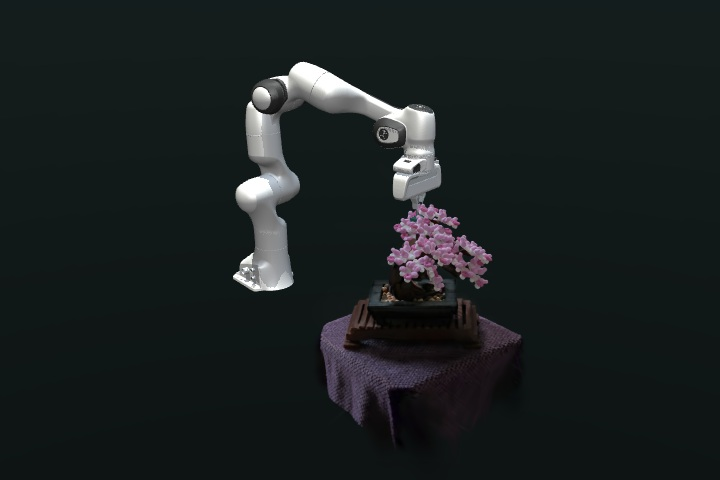
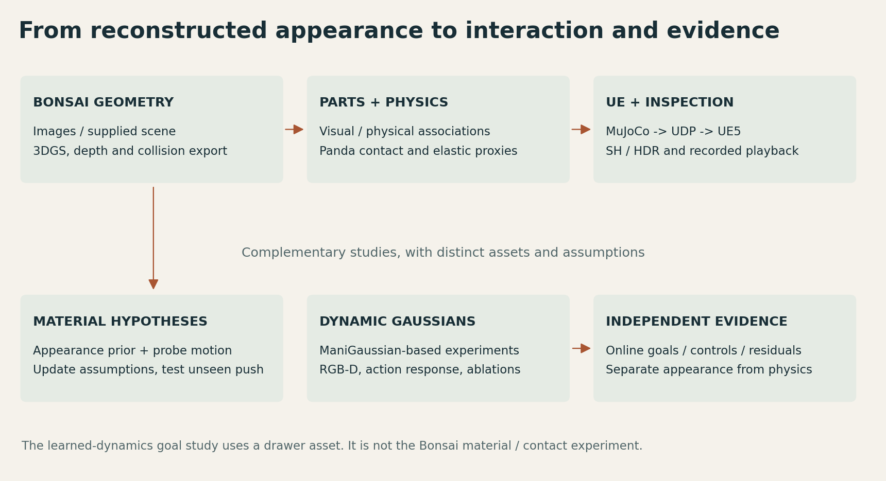
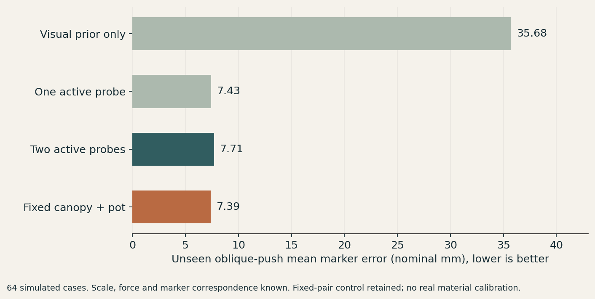
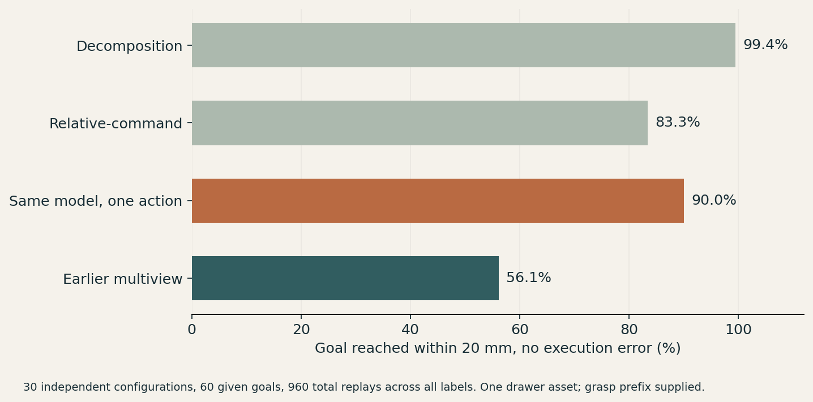

# Physics-Aware Gaussian Digital Twin

**Bonsai reconstruction, part-wise physical assumptions, Franka Panda interaction, UE5 integration and Gaussian world-model experiments.**

Research engineering project by [cusdn](https://github.com/cusdn). Evidence snapshot: November 2026.

[Live demo](https://cusdn.github.io/gaussian-interaction-showcase/) · [Canopy contact video](site/media/canopy_brush_soft-contact.mp4) · [Pot push](site/media/pot_push_soft-overview.mp4) · [Trunk response](site/media/stem_nudge_soft-contact.mp4) · [Results and scope](docs/EVIDENCE.md)

The primary demonstration is a robot physically interacting with a reconstructed Bonsai through part-wise proxies. It is followed by reconstruction / collision engineering, UE playback, material-hypothesis experiments, dynamic Gaussian studies and an independent real-pushing evaluation. Separate studies use different assets and evaluation conditions. They are not merged into a claim of one universally accurate world model.

This is a presentation-only showcase. Research source, core algorithms, weights, training recipes, raw data, trajectories, remote configuration and original Git history are excluded. The owner approved this presentation media set. Underlying Bonsai capture / derived-media licensing has not been conclusively verified, and upstream rights are retained. [Media scope](MEDIA_NOTICE.md).

## Watch the robot interact with a Gaussian scene

The primary scene uses all **239,941 Gaussians** of a supplied public Bonsai representation. Persistent association links appearance to the pot, stand, trunk and canopy parts. Joint motors drive a Franka Panda and contact paddle. The engine solves contact and equivalent elastic joints; a paired run disables robot / object contact while replaying the same motor commands.

| Recorded condition | Pot peak displacement | Maximum canopy peak displacement | Peak normal contact force |
|---|---:|---:|---:|
| Pot push | 70.86 mm | 87.75 mm | 13.186 N |
| Canopy brush | 0.05 mm | 39.25 mm | 0.313 N |
| Trunk nudge | 3.58 mm | 133.83 mm | 6.717 N |
| Canopy brush, alternate material assumptions | 0.14 mm | 40.19 mm | 0.639 N |

The site includes **eight original clips**, with full-scene / contact views for four conditions, synchronized play / pause, timeline seeking, replay, looping and 0.25×–2× speed. Part-color and original-appearance views illustrate the association. In the soft canopy brush, the three canopy parts end within 0.75 nominal mm of their settled reference after withdrawal.

These are nominal simulation measurements with assumed scale and material settings. The alternate condition changes several factors together. Canopy / trunk are equivalent rigid parts with elastic joints, not individual-leaf or continuum models. These contact recordings use SH0 and baked appearance. They do not recompute Gaussian shadows or establish real-plant calibration.

## Reconstruction, collision geometry and UE5

- **Actual Bonsai training.** Gaussian Grouping, 255 training images, 30,000 iterations, 2,453,898 Gaussians. Thirty-seven same-capture image-loss holdout views give **31.437 dB PSNR / 0.9364 SSIM**. Supplied COLMAP uses the capture, and later development reused these views. This is a separate model from the contact scene.
- **Depth-to-collision engineering.** Camera-depth backprojection, multiview fusion / consistency, robust surface fitting and collision export. Surface, contact and controller outcomes are assessed separately. The combined consistency / robust baseline did not beat robust-only fitting in controlled tests.
- **Live integration.** MuJoCo → UDP → native C++ → UE5, with coordinate, rigid-body pose and Gaussian state checks.
- **Complete SH / HDR.** A separate trained-model UE candidate preserves third-order SH, supports HDR attributes and has later actual DX11 / live-state validation. It is not the older supplied-scene color-corrected recording included here.
- **Native playback controls.** Play / pause, replay, five speed settings, loop and scrub in the UE window. This is recorded MuJoCo state playback; changing playback speed does not solve new physics.

[Actual native UE recording](site/media/ue-bonsai.mp4) · [Actual control interface](site/media/ue-controls.png).

Full-SH motion-rebuild frames averaged about 57–59 ms in two limited runs. A high rate of cached frames is not a continuous-motion performance claim. Baked illumination, approximate collision geometry and nominal physical parameters remain limitations.

## Materials as hypotheses, then motion observations

The project associates visible parts with finite material hypotheses, uses an appearance-conditioned prior, maps assumptions to an engine model and updates hypothesis weights from probe responses. Bayesian updating and active probing are studied as a concrete scene-level implementation; these broad ideas have prior literature and are not claimed as original inventions.

For **64 simulated cases**, mean marker prediction error on an unseen oblique push changes from **35.68 mm** with the appearance prior alone to **7.71 mm** after two active probes. One active probe gives 7.43 mm; a suitable fixed canopy / pot probe pair gives 7.39 mm. These controls show that motion observations carry substantial information, while active selection is not consistently superior.

A later frozen study uses **128 new simulated cases / 640 solves**. Target-directed selection gives 6.75 vs 7.02 mm for the preselected fixed pair within the proxy regime, but 11.73 vs 11.26 mm under changed contacts / compliance. The overall cross-condition success criterion is not passed. Known force, registration and marker correspondence are assumed. No real material identification or real-object accuracy is established.

## Dynamic Gaussian world-model experiments

ManiGaussian-based work includes camera / depth interface corrections, multiview supervision, relative-action conditioning, static / dynamic decomposition, training / ablation comparisons and matched retrieval / local-translation controls. The online study predicts candidate outcomes before actual execution, then obtains a new RGB-D observation for a later decision.

The public presentation summarizes this study through the evaluation protocol and aggregate results below. Visual reconstruction retains blur and missing detail; goal-reaching success does not establish high-fidelity scene prediction.

### Post-grasp online goal reaching

**30 independent new configurations, 60 supplied goals, 16 method / seed labels, 960 actual simulation replays.** All use one simulated drawer asset. The expert grasp prefix, command library and target RGB-D are supplied. At most two macro-actions are executed with renewed visual observations.

| Method | Target reached within 20 mm and no execution error | Mean final target error |
|---|---:|---:|
| Static / dynamic decomposition | **99.4%** | **2.11 mm** |
| Relative-command network | 83.3% | 8.91 mm |
| Same decomposition weights, one execution | 90.0% | 5.96 mm |
| Earlier multiview model | 56.1% | 30.50 mm |

Repetitions are not 960 independent configurations. Statistics average goals within configurations, then configurations and training seeds. The paired improvement over the relative-command model is 16.11 percentage points with exploratory 95% interval [10.00, 22.22], without multiple-comparison adjustment.

This is **post-grasp target reaching**, not full autonomous RLBench task success, Bonsai learned manipulation, cross-asset evaluation, Gaussian reconstruction accuracy or real-robot success. The earlier offline selection experiment had less conclusive comparisons against a strong relative-command model. Key novelty and a persistent contact-accurate general world model are not established.

## Additional interactions

- **Free-body stacking:** two free bodies, 32/32 held-out simulations with a known-state waypoint controller. Ideal box geometry and limited parameter variation apply.
- **Domino cascade:** four free bodies, the robot contacts the first only. 32/32 runs record successive neighbor contact and ordered toppling; eight no-action controls stay upright.

[Free-stack UE screenshot](site/media/ue-free-stack.png) · [Domino UE screenshot](site/media/ue-domino.png). Blocks use authored reference Gaussian appearance with reconstructed Bonsai background. These are MuJoCo physics / control demonstrations replayed in UE, not scanned-block reconstruction or learned dynamics predictions.

## Real-record validation

An independent MIT Push Dataset study fits a physics correction and compares command-conditioned endpoint forecasts. It improves position interpolation from 2.151 to 1.832 mm four-corner RMS but loses to calibrated physics under angle / contact-side changes. The overall registered criterion is not passed. Initial state and commanded action are forecast inputs; future executed-tip logs are excluded. Small aggregate facts and an original plot are included, not raw dataset rows or images.

[Detailed experiment boundaries](docs/EVIDENCE.md) · [Aggregate results JSON](site/data/results.json).

## Project contributions and future research

Project work covers representation / coordinate contracts, part association, depth / collision adaptation, Panda / UE integration, SH / HDR interfaces, camera / depth repairs, experiment variants, ablations and independent validation. Established 3DGS, Gaussian Grouping, ManiGaussian, MuJoCo and public data are credited. Full original paper training reproduction, general method novelty, real material calibration and real-robot transfer are not claimed.

Future directions include material calibration, persistent Gaussian state, contact-aware prediction, cross-object tests, relighting and closed-loop manipulation. [Contact cusdn](https://github.com/cusdn) for research collaboration.

## View locally

Open `site/index.html` in a browser. The static page has no runtime dependency installation, model downloads, trackers or live physics execution. Its controls operate only on presentation media. The release is restricted to an exact owner-approved whitelist. Private build / evidence / review files remain outside the public repository. GitHub Pages serves the static site through its dedicated deployment branch.
