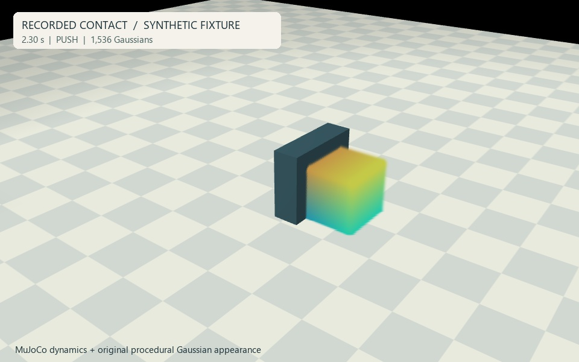
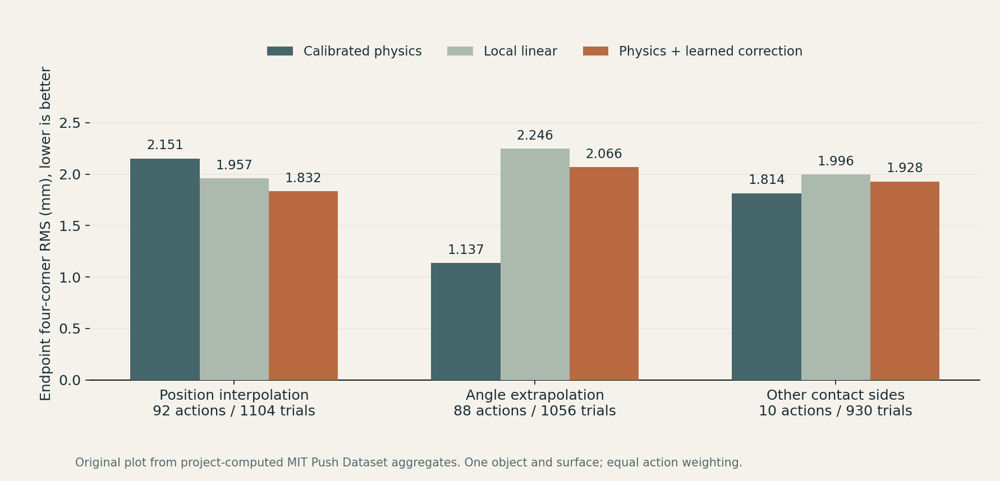

# Gaussian Scene Simulation for Robot Interaction

**A research engineering showcase connecting Gaussian appearance, physical interaction and controlled evaluation.**

Project by [cusdn](https://github.com/cusdn) · Computer graphics / embodied simulation · Evidence snapshot: 12 November 2026.

[Watch the recorded contact clip](site/assets/reference-push.mp4) · [Read the results](docs/RESULTS.md) · [Technical architecture](docs/ARCHITECTURE.md) · [Contribution scope](docs/CONTRIBUTIONS.md)

The original research implementation remains private. This independent presentation contains a static website, original presentation assets and selected aggregate facts. It contains no research source, model weights, raw dataset records or inherited Git history. A deployed website URL will be added only after publication is approved and verified.

## Research problem

Gaussian reconstructions describe how a scene looks. Robot interaction additionally requires geometry, scale, physical assumptions and state transitions. The engineering challenge is to keep the visual representation consistent with those transitions and to distinguish a plausible animation from a tested physical prediction.

This project investigates that connection through scene adapters, part-wise visual / physical binding, contact integration, synchronized rendering and controlled evaluation. Separate experiments assess appearance, simulation integration and endpoint forecasting. They do not establish a universally valid learned Gaussian world model.

## Technical overview

1. Start with images, a supplied Gaussian reconstruction, or an authored reference fixture.
2. Associate persistent visual samples with a scene state and physical parts.
3. Use collision proxies and engine dynamics to evolve the physical state.
4. Render and inspect state-aligned appearance and recorded interactions.
5. Evaluate appearance, contact behavior and prediction under explicitly stated conditions.

Different experiments exercise different subsets. This diagram is a conceptual overview rather than a claim of a fully trained end-to-end system. See the [architecture notes](docs/ARCHITECTURE.md).

## Actual experiments

| Experiment | Observed result | Interpretation |
|---|---|---|
| Original synthetic contact fixture | 1,536 Gaussians, 201 recorded poses over 4 s, 125 mm object displacement along x | A prescribed kinematic pusher contacts a free body solved by MuJoCo. The public clip is a new render of that existing trajectory. Synthetic appearance, no learned policy. |
| Reconstructed Bonsai integration | 239,941 supplied Gaussians, four recorded contact cases | Part-wise physical proxies, persistent identity and covariance transport were checked. Real-object material parameters were not calibrated. Derived natural-scene media is withheld pending licensing clarification. |
| Duck appearance diagnostic | Mean foreground PSNR 21.72 → 23.25 dB; mean silhouette IoU 0.92271 → 0.92368 | Four reused development views. No new independent validation. Residual visual artifacts remain; no dynamics improvement is inferred. |
| Command-conditioned real pushing | Interpolation improves, angle and contact-side transfer do not beat calibrated physics | Offline endpoint prediction on the MIT Push Dataset. The overall registered success test was not passed. |

The public video shows a **synthetic reference fixture**, not the Bonsai or duck reconstruction. Its geometry, colors, floor and annotations are authored in this project. Natural-scene captures and their derived media are omitted while source-image rights remain unresolved.

### Endpoint prediction, including failure under distribution shifts

| Evaluation cohort | Action groups / trials | Calibrated physics | Local linear | Physics + learned correction |
|---|---:|---:|---:|---:|
| Position interpolation | 92 / 1,104 | 2.151 | 1.957 | **1.832** |
| Angle extrapolation | 88 / 1,056 | **1.137** | 2.246 | 2.066 |
| Other contact sides | 10 / 930 | **1.814** | 1.996 | 1.928 |

Values are mean endpoint four-corner RMS in millimeters, lower is better. Training uses 138 nominal action groups / 1,656 trials. Repetitions stay within their action partition; trial scores are averaged within actions before actions are weighted equally. Forecast inputs are initial state and commanded action. Future executed-tip logs are excluded from forecast inputs. These are project baselines, not a state-of-the-art comparison. All cohorts use the same square object and surface; other sides do not constitute cross-object transfer.

Original visualization and aggregate calculations use the [MIT Push Dataset](https://web.mit.edu/mcube/push-dataset/index.html) described by Yu et al., IROS 2016. The dataset is not redistributed or relicensed here. [Full metric scope](docs/RESULTS.md) · [Machine-readable aggregates](site/data/results.json).

## Project contributions

- Scene-to-simulation engineering: coordinate and scale conventions, visual / physical part association, Gaussian state transport and contact-scene adaptation.
- Rendering and inspection: Gaussian / geometry composition, Unreal Engine playback integration, repeatable recordings and browser inspection.
- Evidence and diagnosis: controlled prediction studies, independently recomputed metrics, reconstruction comparisons and explicit negative findings.

Established Gaussian representations, physics engines, upstream paper implementations and datasets are credited separately. No claim is made to invent 3DGS, MuJoCo or the cited research methods. See [contribution boundaries](docs/CONTRIBUTIONS.md) and [sources / licensing](docs/ATTRIBUTION.md).

## Limitations and next research questions

Physical proxies, scale and material assumptions require real-object calibration. Recorded interactions do not demonstrate autonomous policy learning. Baked reconstructed appearance does not recompute Gaussian cast shadows under changing contact or lighting. Duck development-view improvement does not establish unseen-view quality. The endpoint predictor fails the overall transfer criterion. Full paper reproduction, a general learned Gaussian world model and real-robot task success are not claimed.

Research directions include material identification, cross-object / contact evaluation, deformable contact, illumination-aware rendering and closed-loop manipulation with uncertainty-aware scene state.

## View the demo

Open [`site/index.html`](site/index.html) directly in a browser. Video replay, pause, seeking and 0.5× / 1× / 2× playback work locally. The static page has no runtime packages, analytics, external font requests, physics execution or model downloads.

The included [GitHub Pages workflow](.github/workflows/pages.yml) is manual-only and packages `site/`. Repository creation, upload and deployment require the owner's approval. No live link is claimed in this snapshot.

For research collaboration, contact [cusdn through GitHub](https://github.com/cusdn). Original presentation implementation is MIT licensed; see [LICENSE](LICENSE) for its precise scope. Upstream works retain their own rights.
