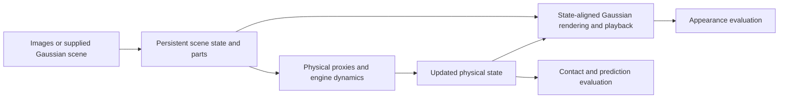
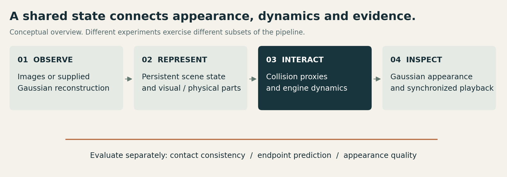

# Technical architecture and scope

The system connects visual and physical representations through explicit state and coordinate contracts. This public overview intentionally omits private algorithms, parameterization, material hypotheses, model internals and training recipes.

## Representation contracts

- A scene adapter expresses scale and coordinate conventions consistently across rendering, collision geometry and playback.
- Persistent visual identities associate Gaussian appearance with physical parts. Part motion transports visual state and covariance.
- Physical proxies approximate contact geometry. Their material settings are assumptions unless independently calibrated.
- Recorded state supports repeatable inspection. The public webpage plays encoded video; it does not run the private pipeline.

## Evidence boundaries

| Study | What is exercised | What is not established |
|---|---|---|
| Synthetic fixture | Engine contact, visual state association, rendering and recorded replay | Reconstruction quality, learned dynamics or policy success |
| Bonsai recordings | Supplied reconstructed appearance, part-wise proxies and contact playback | Measured real-plant mechanics or dynamic relighting |
| Duck diagnostic | Candidate appearance quality on reused views | Independent validation or improved physical behavior |
| Real pushing | Offline command-conditioned endpoint prediction | Online Gaussian rollout, cross-object transfer or robot task success |

These studies support complementary engineering and empirical findings. They are not a single end-to-end learned pipeline evaluation.

## Integration targets

MuJoCo provides contact dynamics. Unreal Engine playback integration and browser inspection provide presentation paths in the original project. Established Gaussian research and public datasets provide upstream representations and evidence. The showcase packages no engine runtime, research implementation, asset source, model weights or experiment trajectories.
