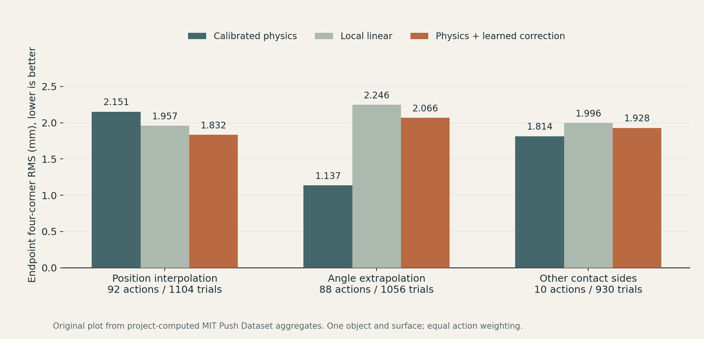

# Experimental results and limits

Snapshot: 12 November 2026. This document reports selected aggregates from completed experiments. It is an evidence summary, not an independently reproducible release of the private research pipeline. Full records and implementations remain private.

## 1. Public contact recording

The reference fixture is an authored procedural Gaussian cube and a kinematic box pusher. MuJoCo 3.2.7 solved free-body motion during an existing completed test. The showcase re-renders its recorded poses with a presentation camera, checker floor and labels. It does not rerun or modify the physical experiment.

- 1,536 original Gaussians, never trained.
- 201 poses over approximately 4 seconds; encoded at 50 frames per second.
- 125 mm object displacement along x.
- The pusher follows a prescribed path. No learned robot policy is involved.
- Gaussian / geometry center-depth composition is an approximation. The recording does not demonstrate new Gaussian cast shadows.

[Video](../site/assets/reference-push.mp4) · [Recorded frame comparison](../site/assets/reference-comparison.jpg).

## 2. Command-conditioned endpoint prediction

Data source: [MIT Push Dataset](https://web.mit.edu/mcube/push-dataset/index.html), Yu et al., IROS 2016. This project uses selected real pushing trials for an offline endpoint forecasting study. The chart and table are new expressions of small project-computed aggregate facts. Raw records and original dataset images are excluded.

Training consists of 138 nominal action groups and 1,656 repetitions. Predictions use the initial state and commanded action. Future measured executed-tip trajectories are excluded from forecast inputs. All repeats of a nominal action stay in the same partition.

For each trial, the endpoint metric is the RMS Euclidean error across the object's four planar corners, in millimeters. Repeated trial scores are averaged within each nominal action, then action groups are weighted equally. Trial counts alone do not determine cohort weighting. These are endpoint scores, not trajectory averages or task success rates.

| Cohort | Actions | Trials | Calibrated physics, mm | Local linear, mm | Physics + learned correction, mm |
|---|---:|---:|---:|---:|---:|
| Position interpolation | 92 | 1,104 | 2.150626 | 1.956826 | 1.831607 |
| Angle extrapolation | 88 | 1,056 | 1.136637 | 2.245811 | 2.066251 |
| Other contact sides | 10 | 930 | 1.813667 | 1.995989 | 1.928250 |

The learned correction improves interpolation relative to the two listed baselines. It loses to calibrated physics under angle extrapolation and other-side evaluation. **The overall registered success test was not passed.** This supports a local empirical gain and a concrete generalization failure. It does not establish a broadly superior world model.

The other-side cohort uses the same square object and surface. It is not cross-object transfer. The original project includes an independent score recomputation of the frozen forecast results; the maximum four-corner score discrepancy across 3,090 evaluation trials is approximately 3.6e-15 mm. This checks numerical scoring consistency, not independent scientific replication.

## 3. Reconstructed-scene integration

A supplied public Bonsai representation contains 239,941 Gaussians. Four recorded conditions cover a pot push, canopy brush, stem nudge and a paired canopy condition with changed assumed material settings. Persistent Gaussian identities and covariance transport were checked through the common part-binding path.

This validates integration and state transport under the tested configuration. The source reconstruction was reused. Assumed scale and part materials were not measured from the physical plant. Recorded responses do not validate true leaf / stem / soil mechanics. Baked scene appearance does not recompute Gaussian shadows after interaction. Media from this reconstruction remains outside this public package pending source-image licensing clarification.

## 4. Duck appearance diagnostic

| Mean metric on the same four development views | Existing baseline | Higher-detail candidate |
|---|---:|---:|
| Foreground PSNR, dB | 21.719812 | 23.247016 |
| Silhouette IoU | 0.922710 | 0.923676 |

These four views were reused during development; there is no new independent validation. The candidate retains visible artifacts. This is an appearance-only comparison. No physical-response improvement or generalization conclusion follows. Derived duck media is excluded while underlying capture rights are unresolved.

## Reuse and reproducibility

The [JSON summary](../site/data/results.json) contains the selected aggregate values and their scope. Core algorithms, weights, per-trial data, calibrated models and trajectories are intentionally absent. The owner's private evidence map records source files and hashes for review, but is not part of this public release.
